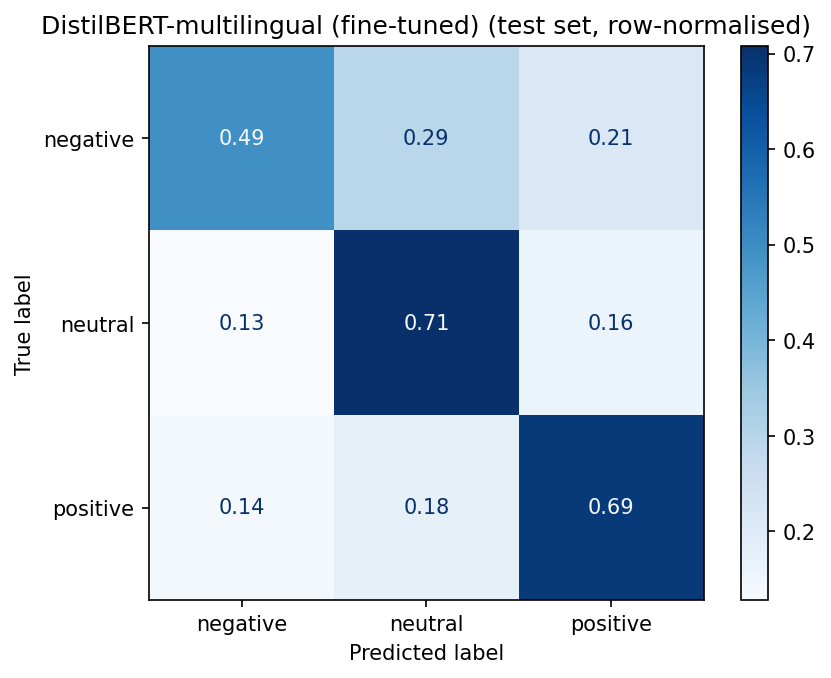
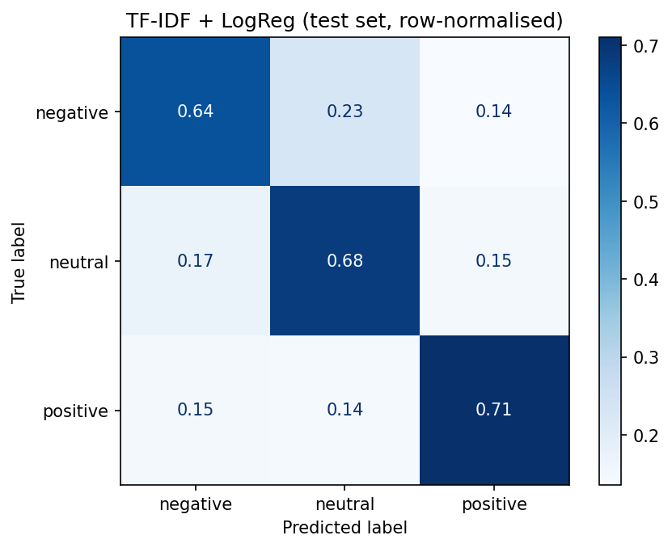

# Roman Urdu Sentiment Classifier

Classifies Roman Urdu customer messages (for example *"mera balance bina wajah kat gaya"*) as **negative**, **neutral** or **positive**, so support teams at telecom and fintech companies can prioritise angry customers automatically.

**Model on Hugging Face Hub:** [aleenakhurshid/roman-urdu-sentiment](https://huggingface.co/aleenakhurshid/roman-urdu-sentiment)

## Why this problem
Millions of Pakistani users write in Roman Urdu: Urdu in English letters, with no fixed spelling (`bohat`, `bahut`, `bht`). Most sentiment models are trained on English and fail here.

## Results (held-out test set)

| Model | Accuracy | Macro F1 |
|---|---|---|
| TF-IDF (word + char n-grams) + Logistic Regression | **0.678** | **0.673** |
| DistilBERT-multilingual, fine-tuned (3 epochs) | 0.644 | 0.628 |

**Key finding:** the classical baseline outperformed the fine-tuned transformer.
Likely reasons: multilingual BERT's subword vocabulary was learned mostly from
Urdu script, not Roman Urdu, so non-standard spellings ("nhi", "kha") get split
into weak subwords, while character n-grams capture spelling variants directly.
Label noise in the dataset also limits how much a larger model can gain.
The baseline is also ~100x smaller and much faster on CPU.

**Why macro F1?** It averages F1 across the three classes equally, so a model cannot look good by only predicting the largest class.

| Fine-tuned DistilBERT | TF-IDF + Logistic Regression |
|---|---|
|  |  |

## Approach
1. **Data:** Roman Urdu Data Set (Sharf, 2017, UCI, CC BY 4.0), about 20k labelled sentences.
2. **Cleaning:** lowercase, remove URLs and mentions, squash stretched letters (`bohtttt → bohtt`), fix label typos, and drop sentences that appear with conflicting labels.
3. **Split:** 80/10/10 stratified train/validation/test. The test set is used once, at the end.
4. **Baseline:** TF-IDF with word n-grams and character n-grams (character n-grams handle spelling variants) + Logistic Regression.
5. **Transformer:** fine-tuned `distilbert-base-multilingual-cased` for 3 epochs on a Colab T4 GPU, keeping the epoch with the best validation macro F1.
6. **Serving:** FastAPI with Pydantic input validation, model loaded once at startup, CPU inference.

The full training run, with outputs and charts, is in [`notebooks/train_colab.ipynb`](notebooks/train_colab.ipynb).

## Project structure
```
roman-urdu-sentiment/
├── notebooks/train_colab.ipynb   # data, baseline, fine-tuning, evaluation (run in Colab)
├── src/preprocess.py             # text cleaning shared by training and serving
├── app/
│   ├── main.py                   # FastAPI routes
│   ├── model.py                  # loads model, runs prediction
│   └── schemas.py                # request/response validation
├── spaces/                       # Gradio demo
├── tests/                        # pytest tests (fake model, no download needed)
├── assets/                       # confusion matrix images
└── requirements.txt
```

## Run locally (Windows, PowerShell)
```powershell
python -m venv .venv
.venv\Scripts\Activate.ps1
pip install torch --index-url https://download.pytorch.org/whl/cpu
pip install -r requirements.txt

$env:MODEL_ID="aleenakhurshid/roman-urdu-sentiment"
uvicorn app.main:app --reload
```
On Linux/Mac, activate with `source .venv/bin/activate` and set the model with `export MODEL_ID=aleenakhurshid/roman-urdu-sentiment`.

The first start downloads the model (~540 MB). Then open http://127.0.0.1:8000/docs to try the API.

### Example request
```
POST /predict
{"text": "mera balance bina wajah kat gaya"}
```
Example response:
```json
{
  "text": "mera balance bina wajah kat gaya",
  "label": "negative",
  "confidence": 0.4849,
  "scores": {"negative": 0.4849, "neutral": 0.3096, "positive": 0.2055}
}
```

### Endpoints
| Method | Path | Purpose |
|---|---|---|
| GET | `/health` | Service health check |
| POST | `/predict` | Classify one message |
| POST | `/predict/batch` | Classify up to 32 messages |

## Tests
```powershell
pytest -q
```
11 tests cover text cleaning and the API (routing, input validation, batch limits). The API tests use a fake model, so they run without downloading the real one.

## Limitations
- Labels in the source dataset are noisy; some "mistakes" are actually questionable labels.
- The data comes from general reviews and social media, not real telecom support tickets.
- Prediction confidence is often modest (around 50% on some clear complaints), so low-confidence predictions should go to human review.
- Sarcasm and mixed Urdu-script/Roman text are not handled well.

## Future work
- Fine-tune `xlm-roberta-base` and tune hyperparameters.
- Serve the baseline in production if it remains the best model.
- Live demo on Hugging Face Spaces.
- Docker image and cloud deployment.

## Acknowledgements
Dataset: Z. Sharf, *Roman Urdu Data Set*, UCI Machine Learning Repository, https://doi.org/10.24432/C58325 (CC BY 4.0).
